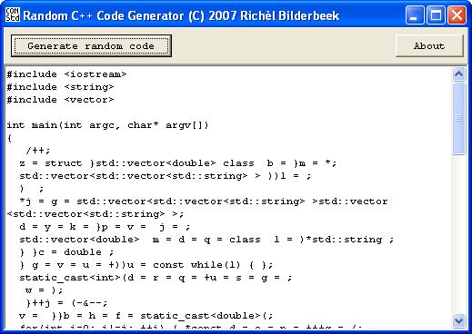

# Random Code (VCL)

Generates random C++ code.

Random Code (VCL) is one of [Richèl Bilderbeek's tools](https://richelbilderbeek.github.io/tools/).

## Links

- [Source code](https://github.com/richelbilderbeek/RandomCodeVcl)
- [Richèl Bilderbeek's tools](https://richelbilderbeek.github.io/tools/)
